# 닿다 (DAHTA)

  

택시 기사님을 위한 Pleos Connect 차량 앱

**닿다 [다타]** —  **손님이 타는 순간부터 내릴 때까지, 차가 대신 말해 주는 택시 기사님용 앱**

[디자인 (Figma)](https://www.figma.com/design/8bvl8era18Ni0CztkeUpMa/DAHTA?node-id=39670-2823&t=LVnRIMttq7YjhKkS-1)

## 01. 서비스 **소개**

### **택시를 부르는 일은 쉬워졌습니다. 탑승한 다음은 어떨까요?**

서울시는 앱 사용이 어려운 시민을 위해 **120 동행콜택시**를 도입했습니다. 서비스는 2025년 7월 시작 이후 약 1년 만에 누적 운행 **6만 3천 건**을 돌파했습니다.

하지만 호출의 문턱이 낮아져도 **탑승 이후의 소통과 안내는 여전히 기사님의 몫**입니다.

### **닿다(DAHTA)는 탑승 이후의 불편에 주목합니다**

**Pleos Connect 기반 택시 운행 어시스턴트**

차량의 도어 상태와 주행 정보, 내비게이션 및 음성 기술을 연결하여 **탑승부터 목적지 확인, 주행, 하차까지 상황에 맞는 안내를 제공**합니다.

승객의 언어로 안내받고, 기사님은 화면 조작과 반복적인 응답을 줄여 운전에 집중할 수 있습니다.

> **호출에서 끝나지 않는 이동의 편리함, 닿다가 이어갑니다.**
>

**자료 출처**

- [서울특별시 — 120 동행콜택시 운영 및 이용 실적](https://www.seoul.go.kr/news/news_report.do?nttNo=464118)
- [서울특별시 — 연령별 택시 이용 방식 및 동행콜택시 도입 배경](https://news.seoul.go.kr/traffic/archives/514632)

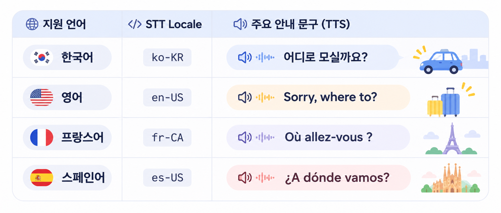

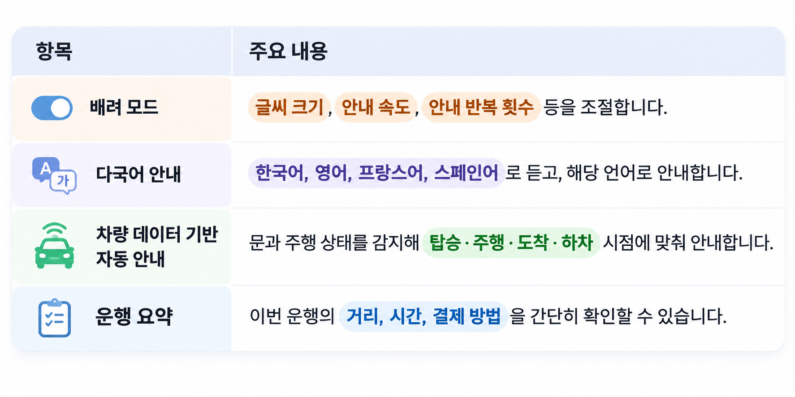

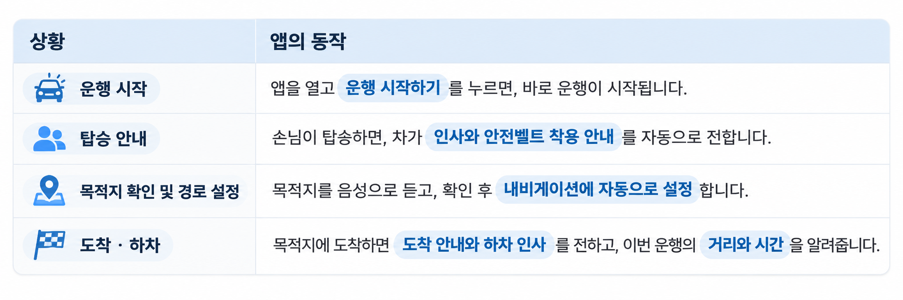

## 시나리오 흐름

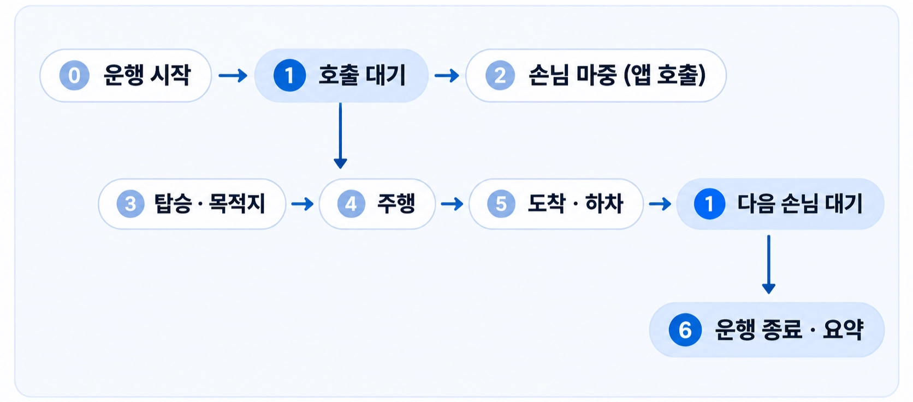

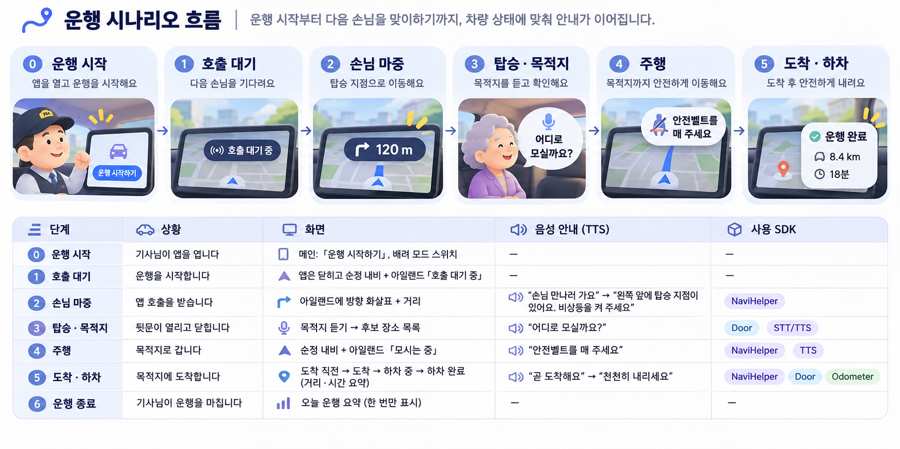

## 주요 시나리오 화면

| | |
| --- | --- |
| 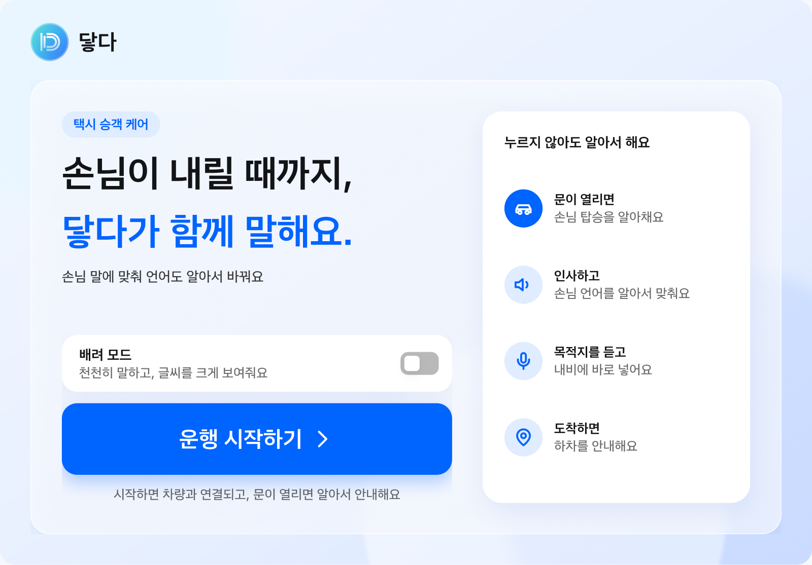 ⓪ 운행 시작 — 메인 화면, 「운행 시작하기」와 배려 모드 | 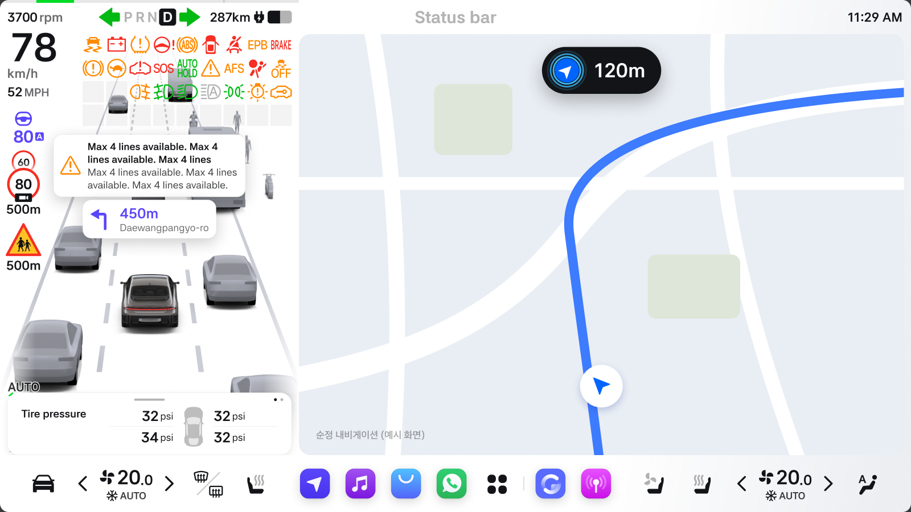 ② 손님 마중 — 아일랜드 화살표가 탑승 지점을 가리킴 |
| 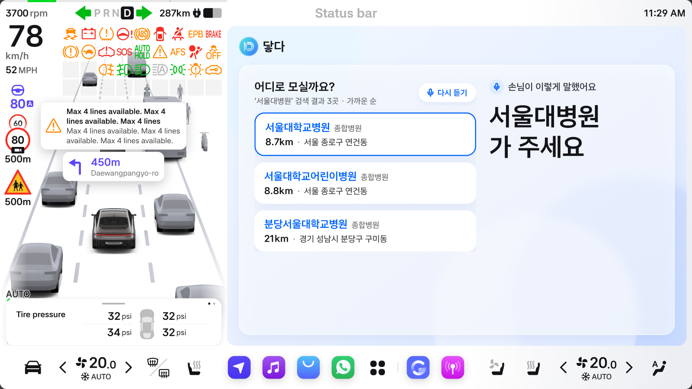 ③ 탑승 · 목적지 — 한국어 손님 "서울대병원 가 주세요" | 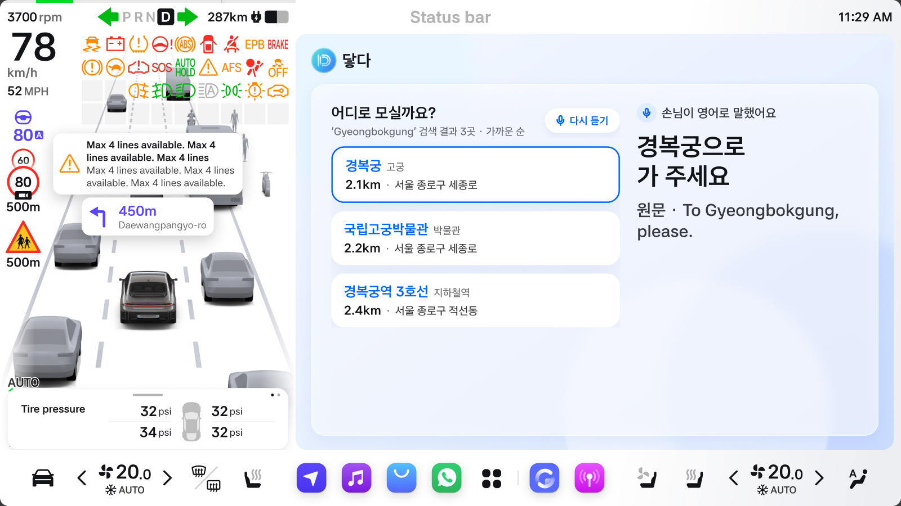 ③ 외국어 손님 — 한국어 뜻은 크게, 원문은 작게 |
| 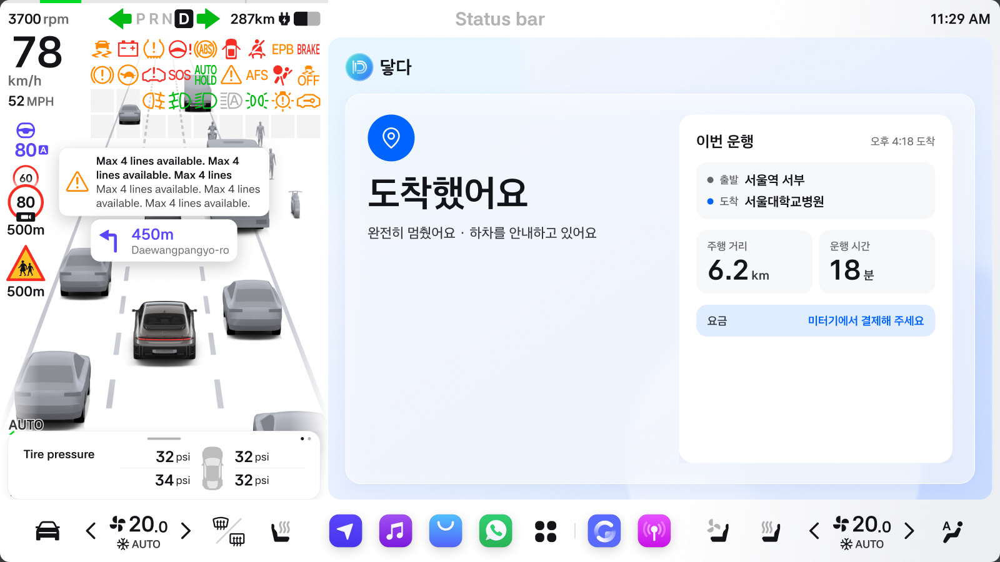 ⑤ 도착 — 이번 운행 거리 · 시간 · 결제 안내 | 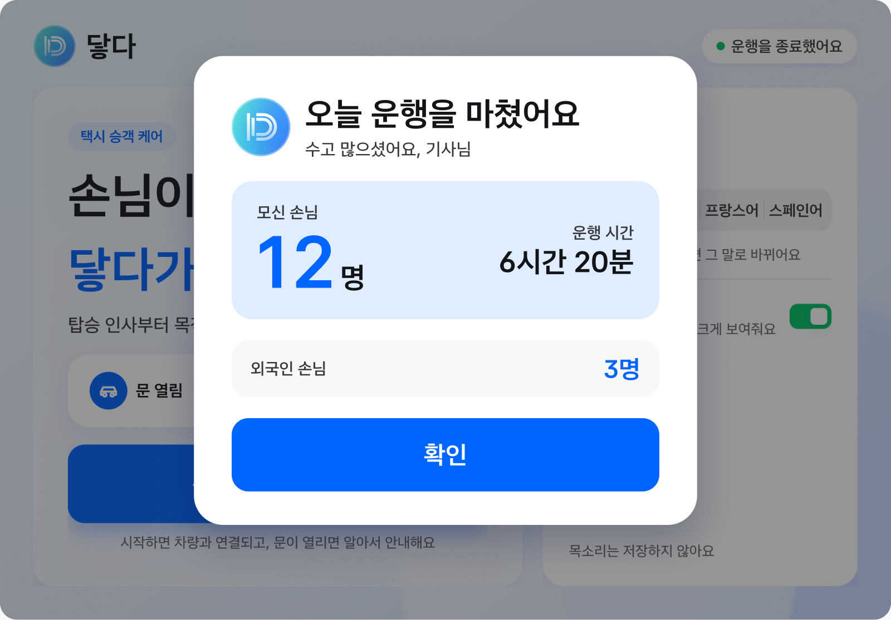 ⑥ 운행 종료 — 오늘 운행 요약 (한 번만 표시) |

## 언어 시나리오

기사님이 한국인이라 **한국어부터** 듣고, 장소를 찾은 언어로 안내 언어를 맞춥니다.

| 순서 | 듣는 언어 (STT) | 다시 물을 때 | 찾으면 안내 (TTS) |
| --- | --- | --- | --- |
| 1 | 한국어 `ko-KR` | 어디로 모실까요? | 안전벨트를 매 주세요 |
| 2 | 영어 `en-US` | Sorry, where to? | Please fasten your seat belt. |
| 3 | 프랑스어 `fr-CA` | Où allez-vous ? | Attachez votre ceinture. |
| 4 | 스페인어 `es-US` | ¿A dónde vamos? | Abróchese el cinturón. |

| 상황 | 화면 |
| --- | --- |
| 외국어 손님의 말 | **한국어 뜻을 크게**, 원문은 작게 ("경복궁으로 가 주세요" / 원문 · To Gyeongbokgung, please.) |
| 결과가 틀렸을 때 (수동) | 「다시 듣기」 → 언어 창: 한국어 · 영어 · 프랑스어 · 스페인어 중 한 번 누르면 바로 듣기 |
| 주행 중 언어 바꾸기 | 언어 창은 잠기고, 음성 명령으로 변경 ("영어로 안내해 줘") |

### 향후 확장성

| 확장 방향 | 기대 효과 |
| --- | --- |
| 다국어 지원 확대 | 외국인 승객의 언어 접근성 향상 |
| 배려 모드 세분화 | 승객과 기사 특성에 따른 안내 방식 개인화 |
| 호출 서비스 연동 확대 | 호출 수신부터 하차까지 일관된 운행 지원 |

## 손님 마중

앱 호출을 받으면 **가운데 화살표가 탑승 지점을 가리킵니다.** 화면 글자는 거리만 두고, 설명은 음성으로 전합니다.

| 상태 | 아일랜드 | 음성 안내 |
| --- | --- | --- |
| 출발 | ↑ 1.2km | "손님 만나러 가요. 1.2킬로미터 남았어요" |
| 가까이 | ↖ 120m | "왼쪽 앞에 탑승 지점이 있어요. 비상등을 켜 주세요" |
| 도착 (정차) | 📍 도착 | "도착했어요. 오른쪽을 봐 주세요" |
- 주간 · 야간에 맞춰 흰색 / 검정 아일랜드를 씁니다.

## 배려 모드

**기사님과 손님 모두를 위한 모드**입니다. 화면을 잘 못 보거나 소리를 천천히 들어야 하는 기사님은 글씨가 크고 고를 것이 적은 화면을, 천천히 안내가 필요한 손님은 느린 말하기와 하차 안내를 받습니다.

| 항목 | 기본 | 배려 모드 ON |
| --- | --- | --- |
| 글씨 크기 | 1.0배 | 1.2배 |
| 말하기 속도 | 1.0x | 0.85x |
| 목적지 후보 | 3개 | 2개 |
| 중요 안내 | 한 번 | 두 번 (도착 1km · 300m) |
| 하차 안내 | 기본 안내 | "천천히 내리세요. 소지품 챙기세요" 한 번 더 |

설정의 **말하기 속도**는 0.5x ~ 1.5x 범위에서 0.05 단위로 바꿀 수 있습니다.

## 개발 환경

<aside>
🚗

모든 기능은 Pleos Connect 에뮬레이터와 Virtual Console에서 개발하고 확인했습니다.

</aside>

| **Item** | **Spec** |
| --- | --- |
| 에뮬레이터 | Pleos Connect Emulator 2.1.0 |
| 기준 디스플레이 | 17" Connect-S |
| 앱 영역 (가로) | 1700 × 1184 |
| 앱 영역 (세로) | 840 × 1184 |
| 차량 입력 | Virtual Console (문 · 기어 · 속도) |

## Pleos 플랫폼 활용

| SDK | Usage |
| --- | --- |
| Vehicle SDK · Door | 탑승 · 하차 감지 |
| Vehicle SDK · 주행 상태 | 주행 중 설정 잠금, 정차 중에만 버튼 표시 |
| Vehicle SDK · Odometer | 운행 거리 |
| NaviHelper | 목적지 전달, 남은 거리 · 시간 |
| STT / TTS | 목적지 듣기, 음성 안내 |

## 개인정보

- **음성 원본과 손님 정보는 저장하지 않습니다.**
- 운행 단계 기록과 기사님 설정만 기기 안에 저장합니다.
- 외부 서버로 보내는 데이터가 없습니다.

## 기술 스택

| Category | Stack |
| --- | --- |
| Language | Java |
| UI | Android XML Views |
| Android | compileSdk / targetSdk 37, minSdk 34, JDK 21 |
| Storage | SQLiteOpenHelper |
| Vehicle | Pleos Connect SDK |
| Design | Figma, Pleos Design System |

## 팀 소개

**TEAM 오라이**

<table width="30%" align="center">
    <tr>
        <td align="center"><b>팀장</b></td>
        <td align="center"><b>팀원</b></td>
        <td align="center"><b>팀원</b></td>
    </tr>
    <tr>
        <td align="center"></td>
        <td align="center"></td>
        <td align="center"></td>
    </tr>
    <tr>
        <td align="center"><b><a href="https://github.com/felizsong">송희</a></b></td>
        <td align="center"><b><a href="https://github.com/mamc325">박성현</a></b></td>
        <td align="center"><b><a href="https://github.com/Wooniq">한지운</a></b></td>
    </tr>
    <tr>
        <td align="center"><b>기획 · 개발</b></td>
        <td align="center"><b>기획 · 개발</b></td>
        <td align="center"><b>기획 · 개발</b></td>
    </tr>
</table>
